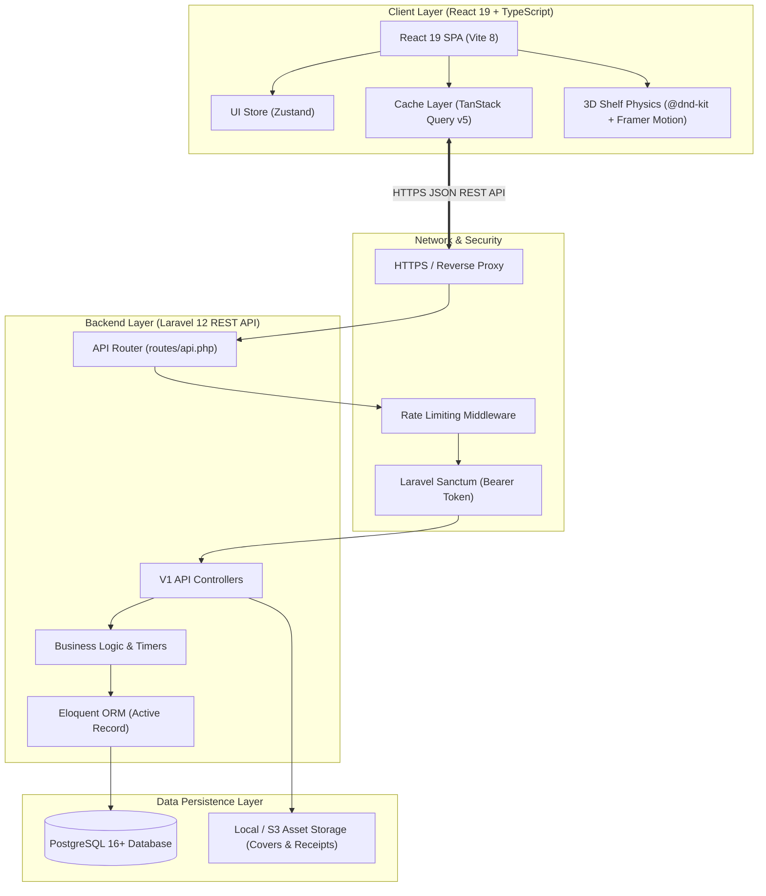
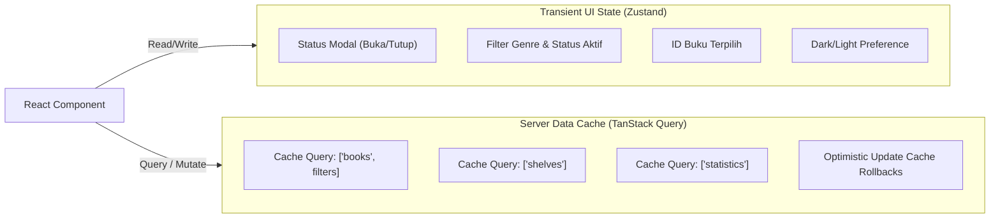

# System Architecture Specification
## MyBookshelf Engineering Blueprint

Dokumen arsitektur sistem ini menguraikan struktur tingkat tinggi, subsistem klien-server, aliran data, dan prinsip rekayasa yang menggerakkan platform **MyBookshelf**.

---

## 1. Ikhtisar Arsitektur Tingkat Tinggi

MyBookshelf dirancang menggunakan pola **Decoupled Client-Server Architecture** (pemisahan penuh antara antarmuka pengguna SPA dan penyedia layanan backend RESTful).



---

## 2. Subsistem Backend (Laravel 12 API)

### 2.1. Karakteristik Teknis
* **Framework:** Laravel 12.x
* **Bahasa:** PHP 8.2+ dengan strict types
* **Autentikasi:** Laravel Sanctum (`auth:sanctum`) berbasis Personal Access Token
* **Routing Prefix:** `/api/v1/`
* **Format Payload:** Stateless JSON (`application/json`) dengan standardisasi respons:
  ```json
  {
    "success": true,
    "message": "Operasi berhasil",
    "data": { ... }
  }
  ```

### 2.2. Modularisasi Controller
Backend diorganisir di dalam `app/Http/Controllers/Api/V1/`:
* `AuthController`: Menangani lifecycle sesi token (`login`, `logout`, `me`, profil, dan ganti password).
* `BookController`: Operasi siklus hidup buku (CRUD, kalkulasi progres, favorite, status transition: `start`, `finish`, `borrow`, `return`, `read-again`).
* `ShelfController`: Manajemen tata letak (*layout*) rak, kapasitas tampung, urutan rak, dan data okupansi.
* `ReadingSessionController`: Pelacakan sesi membaca waktu-nyata dengan kemampuan jeda (*pause*) dan resume.
* `StatisticsController`: Agregasi analitik frekuensi membaca mingguan/bulanan, tren genre, dan pencapaian target.
* `AccountingReportController` & `ExpenseController`: Modul akuntansi pembukuan anggaran buku, konversi mata uang, dan pencatatan transaksi pembelian.

---

## 3. Subsistem Frontend (React 19 SPA)

### 3.1. Karakteristik Teknis
* **Framework:** React 19.x
* **Bahasa:** TypeScript 5.7+ / 6.0 (Strict mode diaktifkan)
* **Build Engine:** Vite 8.x
* **Routing:** React Router DOM v7 (Client-Side Routing)
* **Styling:** Tailwind CSS 3.4 dengan PostCSS & Autoprefixer
* **Data Fetching:** TanStack Query v5 (React Query)
* **Animasi:** Framer Motion v12 & Anime.js v4

### 3.2. Pola Arsitektur State Management

Aplikasi memisahkan state secara murni ke dalam 2 domain:



---

## 4. Metrik & Target Rekayasa Performa

| Parameter Performa | Target Rekayasa | Mekanisme Pencapaian |
| :--- | :--- | :--- |
| **Latensi API Response** | `< 120ms` (P95) | Query indexing PostgreSQL, eager loading Eloquent (`with(['shelf', 'sessions'])`), menghindari N+1 query. |
| **FPS Animasi 3D** | `60 FPS` stabil | CSS 3D hardware-accelerated transforms (`transform: translate3d`), menghindari re-layout DOM berat. |
| **Network Request Deduplication** | Pengurangan `~45%` | `staleTime` dan `gcTime` pada TanStack Query, mencegah refetch redundant saat ganti tab. |
| **Bundle Size First Load** | `< 460KB` Gzip | Code-splitting per halaman via `React.lazy()` dan dynamic import pada chart/modal besar. |
| **Data Integrity Guarantee** | `Zero Data Loss` | Foreign key cascade constraints PostgreSQL, database transactions pada perpindahan rak dan checkout buku. |

---

## 5. Keamanan & Kebijakan Enkripsi

1. **Token Protection:** Token Sanctum dienkripsi dengan SHA-256 di database server dan disimpan secara aman pada storage klien.
2. **Rate Limiting:** Throttle ketat pada endpoint autentikasi (`throttle:5,1` -> maksimal 5 percobaan login per menit) untuk mitigasi serangan brute-force.
3. **Input Sanitization & Schema Validation:** Validasi ganda dilakukan di sisi backend melalui Laravel FormRequests dan di sisi klien menggunakan Zod + React Hook Form sebelum payload dikirim ke jaringan.
