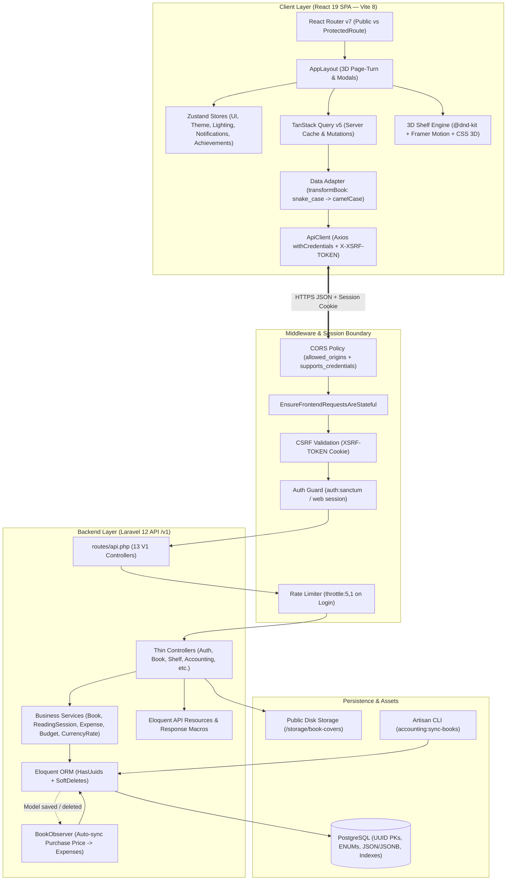
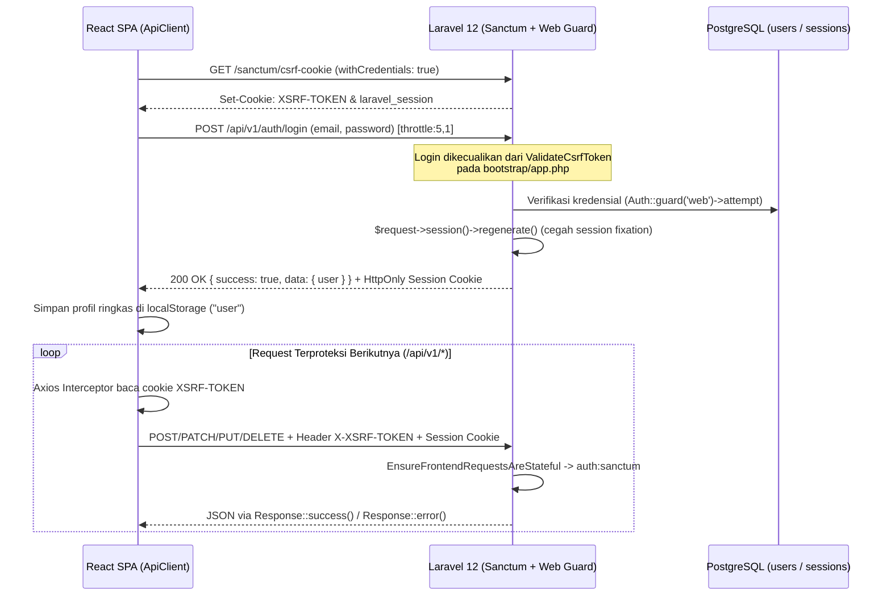

# System Architecture Specification
## MyBookshelf Engineering Blueprint

Dokumen arsitektur sistem ini memetakan topologi teknis, batas subsistem, mekanisme autentikasi, aliran data, dan strategi optimasi performa pada platform **MyBookshelf**. Seluruh komponen yang didokumentasikan mencerminkan implementasi aktual pada basis kode.

---

## 1. Ikhtisar Arsitektur Tingkat Tinggi

MyBookshelf menggunakan pola **Decoupled Client-Server Architecture** dengan pemisahan penuh antara antarmuka klien SPA (**React 19 + TypeScript + Vite 8**) dan server penyedia layanan RESTful API (**Laravel 12 + PHP 8.2+ + PostgreSQL**).

---

## 2. Alur Autentikasi & Keamanan (Sanctum Stateful SPA)

Berbeda dengan skema token statis di `localStorage`, MyBookshelf menerapkan **Laravel Sanctum Stateful Cookie-Based SPA Authentication** (`config/sanctum.php` dan `bootstrap/app.php`):

### Karakteristik Keamanan Terimplementasi
1. **Proteksi Session Fixation & CSRF:** Setiap request mutasi (`POST`, `PUT`, `PATCH`, `DELETE`) menyertakan header `X-XSRF-TOKEN` yang diekstrak dari cookie oleh interceptor di `frontend/src/lib/apiClient.ts`.
2. **Isolasi Kepemilikan Data (*Tenant-Level Ownership*):** Controller dan Service secara eksplisit memfilter query berdasarkan `$request->user()->id` (pada `BookController`, `ShelfController`, `BookService`, `ExpenseService`, `BudgetService`).
3. **JSON Error Boundary:** `bootstrap/app.php` memaksa rendering exception menjadi respons JSON untuk seluruh rute `api/*`, dilengkapi `Route::fallback` HTTP `404` pada `routes/api.php`.
4. **Sanitasi Upload Sampul:** `BookController::uploadCover()` memvalidasi MIME (`jpeg,jpg,png,webp`, maks 5MB) dan menggunakan `$file->extension()` berbasis deteksi MIME alih-alih ekstensi nama file mentah dari klien.

---

## 3. Subsistem Backend (Laravel 12)

Backend mengadopsi pola **Controller -> Service -> Model (+ Observer & Resource)**:
* **Controllers (`app/Http/Controllers/Api/V1/`):** Menangani validasi request HTTP, verifikasi kepemilikan, dan mendelegasikan logika domain ke lapisan Service.
* **Services (`app/Services/`):** Mengenkapsulasi logika bisnis inti (`BookService`, `ReadingSessionService`, `ExpenseService`, `BudgetService`, `CurrencyRateService`).
* **Observer (`app/Observers/BookObserver.php`):** Didaftarkan di `AppServiceProvider::boot()`. Secara otomatis mencatat atau menghapus record `expenses` pada kategori `"Book Purchases"` setiap kali buku dengan `purchase_price > 0` disimpan atau dihapus.
* **Response Macros (`AppServiceProvider::boot()`):** Menstandardisasi format JSON lewat `response()->success($data, $message, $statusCode)` dan `response()->error($message, $errors, $statusCode)`.

---

## 4. Subsistem Frontend (React 19 SPA)

* **Dual Routing Strategy (`frontend/src/App.tsx`):**
  * **Rute Publik:** `/`, `/landing`, `/landing/book/:id`, `/book/:id`, `/login`, `/register`.
  * **Rute Terproteksi (`ProtectedRoute` -> `AppLayout`):** `/dashboard`, `/library`, `/explore`, `/reading`, `/wishlist`, `/borrow-loan`, `/statistics`, `/collections`, `/achievements`, `/notes`, `/accounting`, `/settings`.
* **Data Normalization Adapter (`frontend/src/lib/api/books.ts`):** Fungsi `transformBook()` mengonversi seluruh payload `snake_case` dari API Laravel (`spine_color_light/medium/dark`, `purchase_price`, `current_page`, `started_date`) menjadi struktur `camelCase` TypeScript (`spineColors: [string, string, string]`, `currentPage`, `startedDate`).
* **Event Bus Terbatas untuk Rak:** `Bookshelf.tsx` memicu custom window events (`editShelf`, `deleteShelf`) yang ditangkap oleh `AppLayout.tsx` untuk membuka modal edit/hapus rak tanpa prop drilling berlebih.

---

## 5. Strategi Optimasi Performa Terverifikasi

Optimasi berikut benar-benar terimplementasi di dalam kode:
1. **Konfigurasi Cache TanStack Query (`frontend/src/lib/reactQuery.ts`):**
   * `staleTime: 5 * 60 * 1000` (5 menit data dianggap segar, mencegah refetch berulang saat navigasi antar halaman).
   * `gcTime: 10 * 60 * 1000` (10 menit retensi memori cache).
   * `refetchOnWindowFocus: false` (mencegah burst request saat pengguna berpindah tab browser).
   * `retry: 1` untuk query maupun mutasi.
2. **Memoization Rendering Rak 3D:** Komponen kritis pada jalur render rak (`RealisticBook`, `BookSpine`, `LibraryShelf`, `ShelfWoodFrame`, `ShelfBooksTrack`, `ShelfInfoBar`, `LightingControl`, `LightingControlPanel`) dibungkus `React.memo`, sedangkan kalkulasi geometri dan statistik dibungkus `useMemo` (`useDashboardStats`, `useYearlyStats`, `Book.tsx`).
3. **Indeks Basis Data PostgreSQL:** Indeks tunggal dan komposit (`['user_id', 'expense_date']`, `['user_id', 'period']`, `['user_id', 'event_date']`) serta indeks pada kolom filter utama `books` (`user_id`, `shelf_id`, `status`, `favorite`, `genre`, `format`, `author`, `title`, `date_added`).
4. **Hardware-Accelerated CSS 3D:** Animasi perpindahan halaman (`rotateY`, `perspective: 1200px`, `transformStyle: preserve-3d`) dan buku 3D dikendalikan oleh GPU via CSS transforms & Framer Motion spring physics tanpa engine WebGL eksternal.
