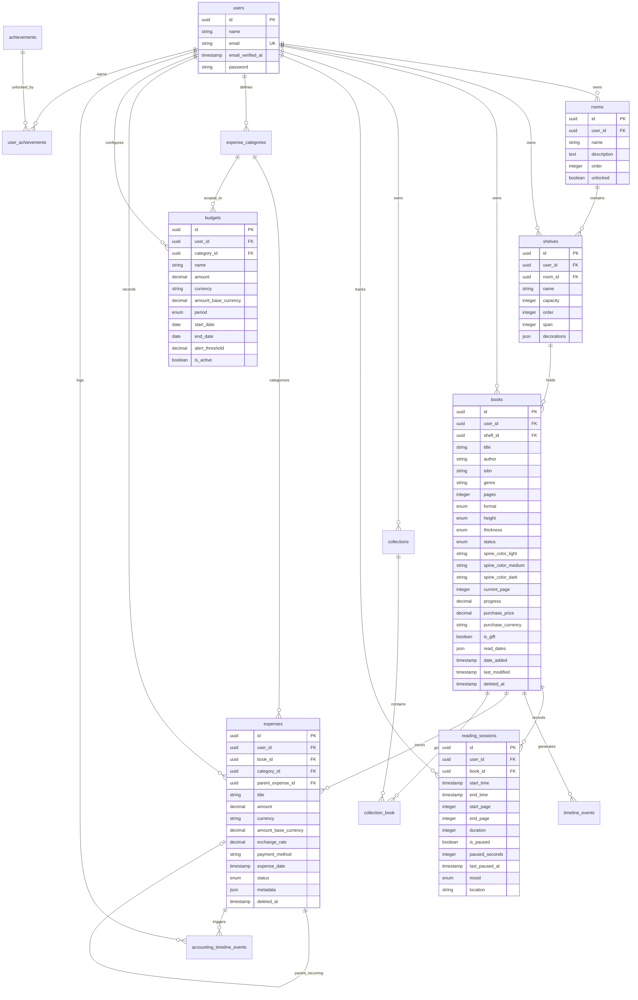

# Database Schema & Data Models Specification (PostgreSQL)
## MyBookshelf Engineering Blueprint

Dokumen ini mendokumentasikan skema basis data **PostgreSQL** (`DB_CONNECTION=pgsql`) aktual berdasarkan seluruh berkas migrasi di `database/migrations/` dan model Eloquent di `app/Models/`. Seluruh tabel entitas utama menggunakan **UUID Primary Key (`uuid('id')->primary()`)**.

---

## 1. Entity-Relationship Diagram (ERD)

---

## 2. Spesifikasi Skema Tabel Inti

### 2.1. `users`, `rooms`, dan `shelves`

* **`users`** (`0001_01_01_000000_create_users_table.php`):
  * `id`: `UUID` Primary Key.
  * `name` (`VARCHAR`), `email` (`VARCHAR UNIQUE`), `email_verified_at` (`TIMESTAMP NULL`), `password` (`VARCHAR`), `remember_token`, `timestamps`.
* **`rooms`** (`2026_06_27_190603_create_rooms_table.php`):
  * `id`: `UUID` PK | `user_id`: `UUID` FK -> `users(id)` (`ON DELETE CASCADE`).
  * `name` (`VARCHAR(100)`), `description` (`TEXT NULL`), `order` (`INTEGER DEFAULT 0`), `unlocked` (`BOOLEAN DEFAULT true`).
  * Indeks: `user_id`, `order`.
* **`shelves`** (`2026_06_27_190624`, `06_28_060731`, `07_02_124534`, `07_02_140537`):
  * `id`: `UUID` PK | `user_id`: `UUID NULL` FK -> `users(id)` (`CASCADE`) | `room_id`: `UUID` FK -> `rooms(id)` (`CASCADE`).
  * `name` (`VARCHAR(100)`), `capacity` (`INTEGER DEFAULT 10`), `order` (`INTEGER DEFAULT 0`), `span` (`INTEGER DEFAULT 12`, lebar grid 2–12 kolom), `decorations` (`JSON NULL`, slot kiri/kanan).
  * Indeks: `room_id`, `user_id`, `order`.

---

### 2.2. Tabel `books`

Didefinisikan pada `2026_06_27_190642_create_books_table.php` dan dimodifikasi oleh migrasi tanggal 2 Juli & 2 Agustus 2026 (`read_dates`, `purchase_currency`, `is_gift`, penghapusan constraint unique ISBN, dan ISBN nullable hingga 50 karakter).

| Kolom | Tipe Data PostgreSQL | Nullable | Default | Keterangan |
| :--- | :--- | :--- | :--- | :--- |
| `id` | `UUID` | Tidak | - | Primary Key (`HasUuids`) |
| `user_id` | `UUID` | Tidak | - | FK -> `users(id)` `ON DELETE CASCADE` |
| `shelf_id` | `UUID` | Ya | `NULL` | FK -> `shelves(id)` `ON DELETE SET NULL` |
| `title` / `author` | `VARCHAR(255)` | Tidak | - | Judul dan pengarang |
| `isbn` | `VARCHAR(50)` | Ya | `NULL` | Non-unique (unique index telah di-drop) |
| `genre` / `language` | `VARCHAR(100)` / `VARCHAR(50)` | Tidak | `'Fiction'` / `'English'` | Klasifikasi literatur |
| `publisher` / `publish_year` | `VARCHAR(255)` / `INTEGER` | Ya | `NULL` | Data penerbitan |
| `pages` | `INTEGER` | Tidak | `0` | Total halaman buku |
| `format` | `ENUM` | Tidak | `'paperback'` | `hardcover`, `paperback`, `ebook`, `audiobook` |
| `height` | `ENUM` | Tidak | `'medium'` | `short`, `medium`, `tall` |
| `thickness` | `ENUM` | Tidak | `'regular'` | `thin`, `regular`, `thick` |
| `status` | `ENUM` | Tidak | `'unread'` | `unread`, `reading`, `finished`, `wishlist`, `borrowed` |
| `spine_color_light/medium/dark` | `VARCHAR(7)` (3 kolom) | Tidak | `#CCC`/`#999`/`#666` | Dipecah 3 kolom hex untuk kompatibilitas PostgreSQL |
| `cover_image` | `VARCHAR(500)` | Ya | `NULL` | URL gambar sampul terunggah |
| `position` | `INTEGER` | Tidak | `0` | Posisi buku di rak |
| `favorite` | `BOOLEAN` | Tidak | `false` | Penanda buku favorit |
| `current_page` | `INTEGER` | Ya | `NULL` | Halaman terakhir yang dibaca |
| `progress` | `DECIMAL(5,2)` | Tidak | `0` | Persentase baca (`0.00` s/d `100.00`) |
| `started_date` / `finished_date` / `estimated_start_date` | `TIMESTAMP` | Ya | `NULL` | Penjadwalan & tanggal baca |
| `read_dates` | `JSON` | Ya | `NULL` | Array tanggal penyelesaian baca ulang |
| `borrowed_by` / `borrowed_date` / `due_date` / `is_returned` | `VARCHAR` / `TIMESTAMP` / `BOOL` | Ya | `is_returned: false` | Pelacakan peminjaman |
| `personal_notes` / `personal_rating` | `TEXT` / `DECIMAL(2,1)` | Ya | `NULL` | Catatan & rating (`0.0` s/d `5.0`) |
| `purchase_date` / `purchase_price` | `TIMESTAMP` / `DECIMAL(8,2)` | Ya | `NULL` | Informasi pembelian |
| `purchase_currency` / `is_gift` / `purchase_location` | `VARCHAR(3)` / `BOOL` / `VARCHAR(255)` | Ya | `'IDR'` / `false` | Mata uang pembelian & status hadiah |
| `date_added` / `last_modified` | `TIMESTAMP` | Tidak | `CURRENT_TIMESTAMP` | Custom timestamp `CREATED_AT` / `UPDATED_AT` |
| `deleted_at` | `TIMESTAMP` | Ya | `NULL` | Soft Delete (`SoftDeletes`) |

**Indeks `books`:** `user_id`, `shelf_id`, `status`, `favorite`, `genre`, `format`, `author`, `title`, `date_added`.

---

### 2.3. Tabel `reading_sessions`, `timeline_events`, `collections`, dan `achievements`

* **`reading_sessions`** (`2026_06_27_190721`, `06_28_225312`, `07_03_213806`):
  * `id` (`UUID` PK), `user_id` (`UUID NULL` FK -> `users`), `book_id` (`UUID` FK -> `books` `CASCADE`).
  * `start_time` (`TIMESTAMP`), `end_time` (`TIMESTAMP NULL`), `start_page` (`INTEGER DEFAULT 0`), `end_page` (`INTEGER NULL`), `duration` (`INTEGER NULL`, dalam detik).
  * Kontrol jeda timer: `is_paused` (`BOOLEAN DEFAULT false`), `paused_seconds` (`INTEGER DEFAULT 0`), `last_paused_at` (`TIMESTAMP NULL`).
  * Konteks sesi: `mood` (`ENUM`: `great`, `good`, `okay`, `difficult`), `location` (`VARCHAR(255) NULL`), `notes` (`TEXT NULL`).
  * Indeks: `book_id`, `user_id`, `start_time`.
* **`timeline_events`** (`2026_06_27_190736`):
  * `id` (`UUID` PK), `book_id` (`UUID` FK -> `books` `CASCADE`).
  * `type` (`ENUM`: `added`, `started`, `progress`, `finished`, `favorited`, `loaned`, `returned`), `date` (`TIMESTAMP`), `description` (`VARCHAR(500)`), `metadata` (`JSONB NULL`).
  * Indeks: `book_id`, `date`, `type`.
* **`collections` & `collection_book`** (`2026_06_27_190703`):
  * `collections`: `id` (`UUID`), `user_id` (`UUID`), `name`, `description`, `color` (`VARCHAR(7)`), `icon`, `progress` (`DECIMAL(5,2)`), `deleted_at` (`SoftDeletes`).
  * `collection_book` (pivot): Composite PK `['collection_id', 'book_id']`, `order` (`INTEGER`), `added_at` (`TIMESTAMP`).
* **`achievements` & `user_achievements`** (`2026_06_27_190752`):
  * `achievements`: `id` (`UUID`), `title`, `description`, `icon`, `requirement` (`INTEGER`), `category` (`ENUM`: `books`, `reading`, `collections`, `streaks`, `special`), `rarity` (`ENUM`: `common`, `rare`, `epic`, `legendary`).
  * `user_achievements`: Composite PK `['user_id', 'achievement_id']`, `current` (`INTEGER`), `unlocked` (`BOOLEAN`), `unlocked_date` (`TIMESTAMP NULL`).

---

## 3. Skema Modul Akuntansi (`2026_07_09_000001` – `000005`)

* **`expense_categories`**: `id` (`UUID`), `user_id` (`UUID`), `name` (`VARCHAR(100)`), `description`, `color` (`#3B82F6`), `icon`, `is_default` (`BOOLEAN`), `monthly_budget` (`DECIMAL(10,2) NULL`), `budget_currency` (`VARCHAR(3) DEFAULT 'IDR'`), `deleted_at`.
* **`expenses`**:
  * `id` (`UUID`), `user_id` (`UUID` FK `CASCADE`), `book_id` (`UUID NULL` FK `SET NULL`), `category_id` (`UUID NULL` FK `SET NULL`), `parent_expense_id` (`UUID NULL`, self-referential FK via `DB::statement` `ON DELETE SET NULL`).
  * Nominal: `amount` (`DECIMAL(10,2)`), `currency` (`VARCHAR(3) DEFAULT 'IDR'`), `amount_base_currency` (`DECIMAL(10,2)`), `exchange_rate` (`DECIMAL(10,6) DEFAULT 1`).
  * Detail: `title`, `description`, `payment_method` (`VARCHAR(50) DEFAULT 'cash'`), `expense_date` (`TIMESTAMP`), `is_recurring`, `recurring_period`, `vendor`, `location`, `receipt_data` (`TEXT NULL` base64), `receipt_mime_type`, `receipt_filename`, `has_reminder`, `reminder_date`, `reminder_sent`, `status` (`ENUM`: `pending`, `completed`, `cancelled`), `metadata` (`JSON`), `deleted_at`.
  * Indeks komposit: `['user_id', 'expense_date']` serta indeks pada `user_id`, `book_id`, `category_id`, `expense_date`, `payment_method`, `status`, `is_recurring`, `parent_expense_id`.
* **`budgets`**:
  * `id` (`UUID`), `user_id` (`UUID` FK), `category_id` (`UUID NULL` FK), `name`, `description`, `amount` (`DECIMAL(10,2)`), `currency` (`VARCHAR(3)`), `amount_base_currency` (`DECIMAL(10,2)`), `period` (`ENUM`: `daily`, `weekly`, `monthly`, `yearly`), `start_date` (`DATE`), `end_date` (`DATE NULL`), `alert_threshold` (`DECIMAL(5,2) DEFAULT 80.00`), `is_active` (`BOOLEAN DEFAULT true`), `deleted_at`.
  * Indeks komposit: `['user_id', 'period']`.
* **`currency_rates`**:
  * `id` (`UUID`), `from_currency` (`VARCHAR(3)`), `to_currency` (`VARCHAR(3) DEFAULT 'IDR'`), `rate` (`DECIMAL(12,6)`), `effective_date` (`TIMESTAMP`), `expires_at` (`TIMESTAMP NULL`), `is_active` (`BOOLEAN DEFAULT true`).
  * Unique Constraint: `['from_currency', 'to_currency', 'effective_date']`.
* **`accounting_timeline_events`**:
  * `id` (`UUID`), `user_id` (`UUID`), `expense_id` (`UUID NULL`), `budget_id` (`UUID NULL`), `type` (`ENUM`: `expense_created`, `expense_updated`, `budget_exceeded`, `budget_alert`, `payment_reminder`, `currency_rate_updated`), `event_date` (`TIMESTAMP`), `description` (`VARCHAR(500)`), `metadata` (`JSON NULL`).
  * Indeks komposit: `['user_id', 'event_date']`.
