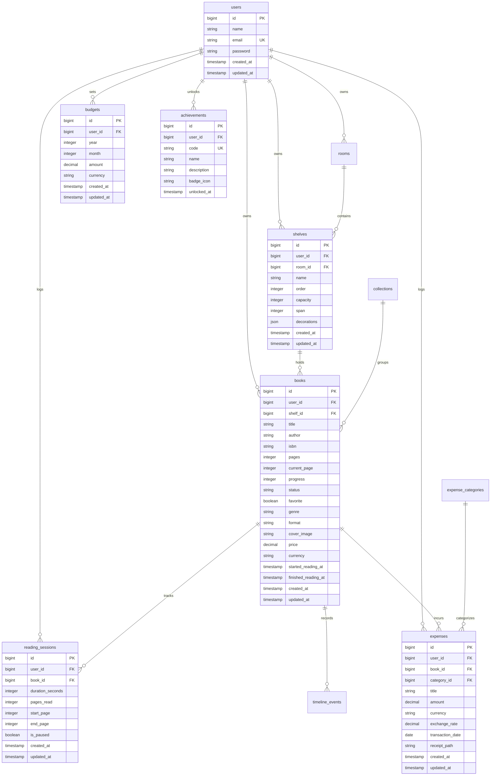

# Database Schema & Data Models Specification
## MyBookshelf Engineering Blueprint

Dokumen ini mendokumentasikan skema basis data PostgreSQL resmi untuk aplikasi MyBookshelf, mencakup relasi antar entitas (ERD), spesifikasi tabel, tipe data, indeks, dan batasan integritas (*constraints*).

---

## 1. Entity-Relationship Diagram (ERD)

---

## 2. Rincian Skema Tabel Utama

### 2.1. Tabel `books`
Menyimpan data katalog buku, progres baca, dan metadata fisik.

| Nama Kolom | Tipe Data | Nullable | Nilai Default | Keterangan |
| :--- | :--- | :--- | :--- | :--- |
| `id` | `BIGSERIAL` | Tidak | Auto-increment | Primary Key |
| `user_id` | `BIGINT` | Tidak | - | Foreign Key -> `users(id)` ON DELETE CASCADE |
| `shelf_id` | `BIGINT` | Ya | `NULL` | Foreign Key -> `shelves(id)` ON DELETE SET NULL |
| `title` | `VARCHAR(255)` | Tidak | - | Judul buku |
| `author` | `VARCHAR(255)` | Tidak | - | Nama penulis/pengarang |
| `isbn` | `VARCHAR(20)` | Ya | `NULL` | Nomor standar buku internasional |
| `pages` | `INTEGER` | Tidak | `0` | Total jumlah halaman |
| `current_page` | `INTEGER` | Tidak | `0` | Halaman terakhir yang dibaca |
| `progress` | `INTEGER` | Tidak | `0` | Persentase progres baca (0 - 100) |
| `status` | `VARCHAR(30)` | Tidak | `'unread'` | Enum: `unread`, `reading`, `finished`, `wishlist`, `borrowed` |
| `favorite` | `BOOLEAN` | Tidak | `false` | Penanda buku favorit |
| `genre` | `VARCHAR(100)` | Ya | `NULL` | Kategori/genre buku (komma-terpisah) |
| `format` | `VARCHAR(50)` | Ya | `'Hardcover'` | Format fisik: `Hardcover`, `Paperback`, `E-Book` |
| `cover_image` | `TEXT` | Ya | `NULL` | Path URL atau gambar cover lokal |
| `price` | `DECIMAL(12,2)`| Ya | `0.00` | Harga perolehan buku |
| `currency` | `VARCHAR(3)` | Ya | `'IDR'` | Kode mata uang transaksi (IDR, USD, EUR) |
| `personal_rating`| `DECIMAL(2,1)`| Ya | `NULL` | Rating kepuasan pembaca (1.0 - 5.0) |
| `notes` | `TEXT` | Ya | `NULL` | Catatan/review personal pembaca |
| `started_reading_at` | `TIMESTAMP` | Ya | `NULL` | Timestamp awal mulai membaca |
| `finished_reading_at`| `TIMESTAMP` | Ya | `NULL` | Timestamp penyelesaian baca |

**Indeks:**
* `INDEX books_user_id_idx (user_id)`
* `INDEX books_shelf_id_idx (shelf_id)`
* `INDEX books_status_idx (status)`
* `INDEX books_favorite_idx (favorite)`

---

### 2.2. Tabel `shelves`
Menyimpan konfigurasi rak fisik 3D, tata letak, kapasitas, dan dekorasi.

| Nama Kolom | Tipe Data | Nullable | Nilai Default | Keterangan |
| :--- | :--- | :--- | :--- | :--- |
| `id` | `BIGSERIAL` | Tidak | Auto-increment | Primary Key |
| `user_id` | `BIGINT` | Tidak | - | Foreign Key -> `users(id)` |
| `room_id` | `BIGINT` | Ya | `NULL` | Foreign Key -> `rooms(id)` |
| `name` | `VARCHAR(100)` | Tidak | - | Nama rak (cth: "Sedang Dibaca", "Favorit") |
| `order` | `INTEGER` | Tidak | `0` | Urutan penataan vertikal rak di layar |
| `capacity` | `INTEGER` | Tidak | `20` | Batas maksimum kapasitas buku di rak |
| `span` | `INTEGER` | Tidak | `12` | Kolom responsive grid (span 1 sampai 12) |
| `decorations` | `JSONB` | Ya | `'[]'` | Data posisi dekorasi (tanaman, lilin, jam) |

---

### 2.3. Tabel `reading_sessions`
Mencatat histori sesi membaca aktual dengan timer.

| Nama Kolom | Tipe Data | Nullable | Nilai Default | Keterangan |
| :--- | :--- | :--- | :--- | :--- |
| `id` | `BIGSERIAL` | Tidak | Auto-increment | Primary Key |
| `user_id` | `BIGINT` | Tidak | - | Foreign Key -> `users(id)` |
| `book_id` | `BIGINT` | Tidak | - | Foreign Key -> `books(id)` ON DELETE CASCADE |
| `duration_seconds` | `INTEGER` | Tidak | `0` | Durasi sesi membaca dalam detik |
| `pages_read` | `INTEGER` | Tidak | `0` | Jumlah halaman yang diselesaikan di sesi ini |
| `start_page` | `INTEGER` | Tidak | `0` | Halaman awal sesi |
| `end_page` | `INTEGER` | Tidak | `0` | Halaman akhir sesi |
| `is_paused` | `BOOLEAN` | Tidak | `false` | Status jeda timer membaca |

---

### 2.4. Tabel `expenses` & `budgets` (Sistem Akuntansi Buku)
Modul pelacakan keuangan untuk logging anggaran dan pengeluaran literatur.

* **`expenses`**:
  * `amount`: Nilai nominal transaksi (Desimal).
  * `currency`: Simbol mata uang asli.
  * `exchange_rate`: Kurs konversi terhadap mata uang dasar (IDR) pada tanggal transaksi.
  * `receipt_path`: Path bukti struk pembayaran pembelian buku.
* **`budgets`**:
  * `year` & `month`: Periode target keuangan.
  * `amount`: Batas alokasi belanja buku bulanan.
